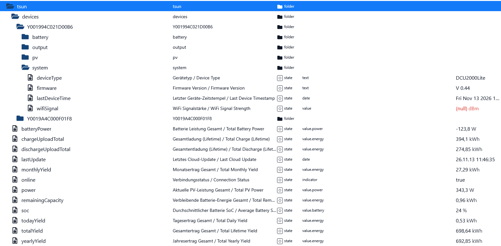

[🇩🇪 Zur deutschen Version](README.md)

# ioBroker TSUN DCU2000Lite Cloud Adapter / Script

[](https://opensource.org/licenses/MIT)
[](https://www.iobroker.net/)

---

## 🇬🇧 Description
A robust JavaScript for **ioBroker** to poll TSUN inverters and DCU2000Lite battery storage systems using the official cloud account.

> **Important Note:** This script relies on enduser cloud login credentials (using OAuth2 authentication with `identity_type: 2` and `system: "TSUN"`).

The script automatically resolves the station ID, filters out physical storage units (`deviceType === 3`), and creates a structured, bilingual (DE/EN) data point hierarchy under `0_userdata.0.tsun.`.

### ioBroker Object Structure (Preview)


### Features
* 🔐 **Automatic OAuth2 login** (including token refresh handling).
* 🔍 **Fully automated device discovery** using real hardware serial numbers.
* 📊 **Comprehensive metrics**: Battery SoC, power, voltage, current, cell voltages, SOH, PV1/PV2 inputs, daily/total yields, and AC output info.
* 🌐 **Bilingual ioBroker objects** (German / English).
* ⏱️ **Configurable poll interval** (Default: 60 seconds).

### Requirements
* ioBroker with an active **JavaScript instance** (`javascript.0`).
* Required Node.js modules enabled in script settings: `axios`, `crypto`, `querystring`.

### Installation & Setup
1. Get the script [`tsun_dcu_collector.js`](tsun_dcu_collector.js) or create a new **JavaScript** in ioBroker.
2. Update your credentials at the top of the script:
   ```javascript
   const TSUN_EMAIL = 'your-email@domain.com';
   const TSUN_PASSWORD = 'your-password';
   const POLL_INTERVAL_SECONDS = 60; // Poll interval in seconds
